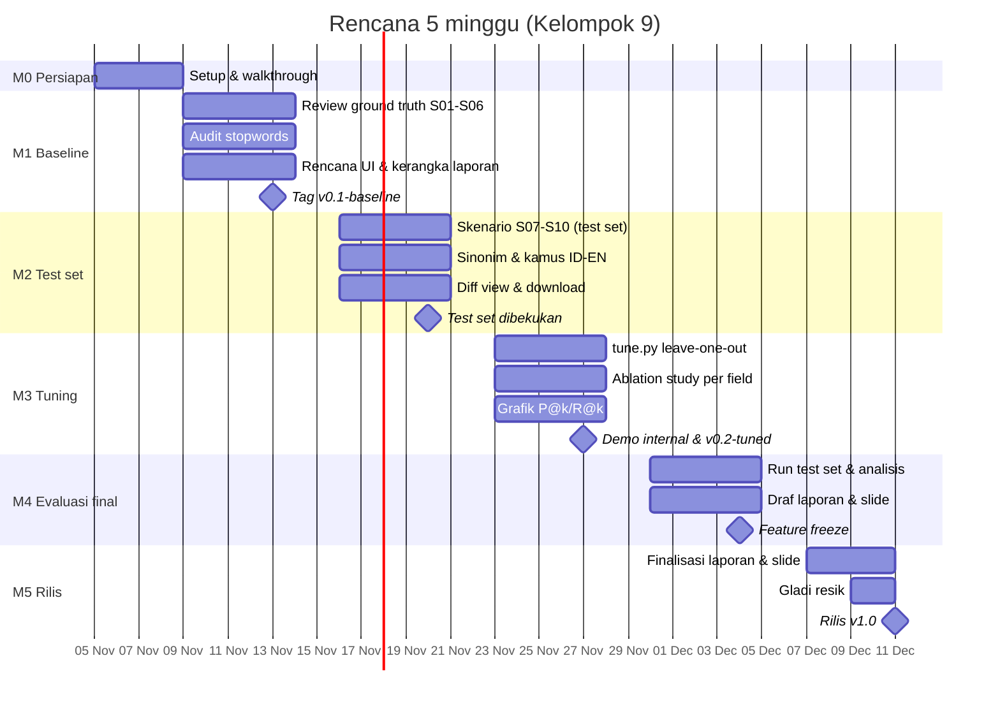

# Milestone Pengerjaan: BPMN Change Impact Retrieval (Kelompok 9)

**Durasi:** 5 minggu, Senin 9 November sampai Jumat 11 Desember 2026, didahului minggu persiapan (5–8 November).
Kalau deadline resmi dari dosen berbeda, geser semua tanggal dengan selisih yang sama. Urutan milestone jangan diubah.

**Titik awal (4 November 2026):** seluruh pipeline sudah berjalan dari BPMN sampai ranking file/fungsi, termasuk
website dan evaluasi. Website juga bisa menerima source code lain dalam bentuk ZIP. Ada 10 skenario (S01–S06 dev
set, S07–S10 test set yang sudah dibekukan), 69 baris ground truth (review pertama S01–S06 sudah selesai, lihat
`data/ground_truth/REVIEW_LOG.md`), 1 pasangan BPMN asli dari riwayat Simple-ERP (`data/bpmn/real/`, untuk demo),
dan 135 test yang lulus.

> **Sudah dikerjakan lebih awal (4 November):** review pertama ground truth (M1) dan pembuatan test set S07–S10
> beserta ground truth-nya (M2). Tugas Orang 3 di M1 dan M2 berubah menjadi **review kedua**: memeriksa ulang
> pekerjaan itu, bukan membuatnya dari awal. Waktu yang tersisa dipakai lebih awal untuk `tune.py` (M3).
Lima minggu ini dipakai untuk
**memvalidasi, memperbaiki, mengevaluasi dengan jujur, dan melaporkan**, bukan untuk membangun dari nol.
Detail teknis ada di [`ARCHITECTURE.md`](ARCHITECTURE.md), dan daftar tugas per modul di [`TASKS.md`](TASKS.md).

---

## Peran

| Peran | Tanggung jawab utama | Folder |
|---|---|---|
| **Lead** | Arsitektur, ekstraksi kode, retrieval, integrasi, review dan merge PR, ablation study | `src/impact_retrieval/code/`, `retrieval/`, `pipeline.py` |
| **Orang 2**: Query | Preprocessing, query builder, kamus sinonim/terjemahan, eksperimen bobot query | `preprocessing/`, `query/` |
| **Orang 3**: Evaluasi | Ground truth, skenario baru, script tuning, eksperimen dan angka hasil | `data/`, `experiments/`, `evaluation/` |
| **Orang 4**: Web & Laporan | Website, visualisasi, laporan akhir, slide, README | `web/`, `docs/` |

Asumsi kapasitas: **±8 jam per orang per minggu**, total ±160 jam untuk tim. Estimasi jam di setiap milestone
mengikuti asumsi ini.

---

## Ringkasan

| # | Milestone | Minggu | Tanggal | Hasil utama | Tag git |
|---|---|---|---|---|---|
| M0 | Persiapan & onboarding | 0 | 5–8 Nov | Semua anggota bisa menjalankan proyek dan paham alurnya | — |
| M1 | Baseline terkunci & ground truth tervalidasi (dev set) | 1 | 9–15 Nov | Angka baseline resmi, ground truth S01–S06 sudah direview | `v0.1-baseline` |
| M2 | Test set & perbaikan kualitas | 2 | 16–22 Nov | Skenario S07–S10 (test set, dibekukan), stopwords dan diff view diperbaiki | — |
| M3 | Eksperimen & tuning | 3 | 23–29 Nov | Konfigurasi terbaik dari tuning di dev set, ablation study, demo internal | `v0.2-tuned` |
| M4 | Evaluasi final & feature freeze | 4 | 30 Nov–6 Des | Hasil di test set, grafik, draf laporan dan slide | `v0.9-rc` |
| M5 | Laporan, presentasi & rilis | 5 | 7–11 Des | Laporan final, slide, gladi resik, rilis | `v1.0` |

### Ritme kerja mingguan
* **Senin (15 menit, online):** setiap orang menyebut target minggu ini dan hambatannya.
* **Kamis:** batas akhir membuka PR untuk pekerjaan minggu itu, supaya Lead punya waktu review.
* **Jumat (30–45 menit):** checkpoint milestone. Cek "Kriteria selesai", jalankan `pytest` dan
  `experiments/run_eval.py` di `main`, lalu catat angkanya di tabel [Log hasil](#log-hasil).
* Semua tugas dibuat sebagai **GitHub Issue** dengan label milestone (`M1` … `M5`) dan dipantau di GitHub Projects.

---

## M0: Persiapan & onboarding (5–8 November)

**Tujuan:** semua anggota bisa menjalankan proyek di laptop masing-masing dan paham alur besarnya, sebelum mulai mengubah kode.

| Peran | Tugas | Estimasi |
|---|---|---|
| Semua | Clone repo, buat venv, `pip install -r requirements.txt` dan `pip install -e .`, clone Simple-ERP ke `data/target_repo`, lalu `pytest` (135 lulus) | 1–2 jam |
| Semua | Jalankan `python -m impact_retrieval.pipeline S03`, buka website (`uvicorn web.app:app --reload`), coba halaman Mapping dan Evaluation, termasuk upload pasangan `data/bpmn/real/` dan upload ZIP | 1 jam |
| Lead | **Sesi walkthrough (1–2 jam):** jelaskan diagram di `ARCHITECTURE.md`, telusuri satu skenario dari BPMN sampai ranking, tunjukkan di mana setiap modul berada | 3 jam (dengan persiapan) |
| Lead | Buat GitHub Project board dan Issue dari `TASKS.md`, atur branch protection `main` (wajib PR) | 1 jam |
| Semua | Baca modul yang akan dipegang sendiri beserta test-nya | 2 jam |

**Deliverable:** setiap anggota memposting screenshot `135 passed` dan halaman website di grup.
Semua Issue M1 sudah dibuat dan di-assign.

**Kriteria selesai:**
- [ ] 4 dari 4 anggota berhasil menjalankan test dan website.
- [ ] Setiap anggota bisa menjelaskan dengan kata sendiri: input dan output modulnya, serta modul mana yang memakai output itu.

**Risiko:** instalasi gagal di salah satu laptop, misalnya karena versi Python atau tree-sitter.
**Mitigasi:** gunakan Python 3.11–3.13. Selesaikan masalah instalasi bersama-sama saat walkthrough.

---

## M1: Baseline terkunci & ground truth tervalidasi (Minggu 1, 9–15 November)

**Tujuan:** menetapkan **angka pembanding resmi** sebelum ada perubahan apa pun, dan memastikan kunci jawaban
S01–S06 benar. Semua perbaikan nanti diukur terhadap baseline ini.

> **Keputusan penting:** S01–S06 resmi menjadi **dev set**, tempat eksperimen dan tuning. Skenario baru di M2 menjadi
> **test set** dan tidak boleh dipakai untuk tuning. Pemisahan ini yang membuat hasil akhir bisa dipercaya.

| Peran | Tugas | Estimasi |
|---|---|---|
| **Orang 3** | **Review kedua** ground truth S01–S06 (50 baris; review pertama sudah selesai dan tercatat di `data/ground_truth/REVIEW_LOG.md`): buka setiap file dan fungsi di Simple-ERP, cocokkan dengan aturan di `data/ground_truth/README.md`. Fokus ke baris yang ditandai *borderline*. Catat setuju/tidak setuju di tabel log. | 4 jam |
| **Orang 3** | Bersama Lead: putuskan kasus yang masih ragu, misalnya `platform/config/config.go` di S05 | 1 jam |
| **Orang 2** | Script `experiments/term_stats.py`: tampilkan 50 term dengan document frequency tertinggi di korpus, dan term query yang tidak pernah muncul di korpus. Hasilnya jadi bahan audit stopwords. | 4 jam |
| **Orang 2** | Usulkan perubahan `code_stopwords` dan `bpmn_stopwords`, plus daftar **stopwords bahasa Indonesia** (`dan`, `atau`, `yang`, ...; temuan dari `data/bpmn/real/`). Belum di-merge, hanya daftar beserta alasannya. | 2 jam |
| **Orang 4** | Rancang perbaikan UI (sketsa halaman Mapping dan Evaluation) dan **kerangka laporan** (judul bab, subbab, tabel/gambar yang dibutuhkan) | 6 jam |
| **Lead** | Review PR, lalu setelah ground truth di-merge: jalankan `run_eval.py`, simpan hasil ke `docs/results/baseline.md`, dan buat tag `v0.1-baseline` | 3 jam |
| **Lead** | Tulis bagian "Metodologi" untuk laporan: pipeline, BM25F, field, baseline | 4 jam |

**Deliverable**
* `data/ground_truth/ground_truth.csv` versi review, plus `data/ground_truth/REVIEW_LOG.md` berisi perubahan dan alasannya.
* `docs/results/baseline.md`: tabel BM25, keyword dan TF-IDF di level file dan fungsi untuk k = 1, 3, 5, 10.
* `experiments/term_stats.py` dan daftar usulan stopwords.
* Kerangka laporan (`docs/report/outline.md`) dan sketsa UI.

**Kriteria selesai**
- [ ] Setiap baris ground truth S01–S06 sudah diperiksa minimal oleh 1 orang selain pembuatnya.
- [ ] Angka baseline tercatat dan tag `v0.1-baseline` ada di GitHub.
- [ ] `pytest` lulus di `main`.

**Ketergantungan:** angka baseline baru boleh diambil setelah review ground truth di-merge.
**Risiko:** review ground truth memakan waktu lebih lama dari perkiraan.
**Mitigasi:** dahulukan S01–S03. Kalau sampai Kamis belum selesai, Lead membantu mereview S04–S06.

---

## M2: Test set & perbaikan kualitas (Minggu 2, 16–22 November)

**Tujuan:** membuat **test set** yang belum pernah dilihat sistem, lalu memperbaiki kualitas query dan tampilan website.

| Peran | Tugas | Estimasi |
|---|---|---|
| ~~Orang 3~~ | ~~Buat S07–S10~~ **Selesai 4 Nov:** S07 kondisi gateway (backorder), S08 message flow baru ke supplier, S09 pindah lane saja, S10 multi-perubahan (2 task). Sudah ada `scenario.md`, 19 baris ground truth, entri `EXPECTED_SCENARIOS`, dan split `test` di config. | — |
| **Orang 3** | **Review ground truth S07–S10** (19 baris) dengan membaca `scenario.md` dan kodenya, **tanpa** melihat hasil ranking. Kesalahan nyata boleh diperbaiki sampai Jumat ini; setelah itu test set dibekukan permanen. | 3 jam |
| **Orang 2** | Terapkan stopwords hasil audit, lalu ukur dampaknya di **dev set saja** (S01–S06) | 3 jam |
| **Orang 2** | Kamus sinonim domain (opsional di config, default mati), dengan test | 4 jam |
| **Orang 2** | Stopwords Indonesia dan kamus Indonesia → Inggris untuk model `docs/bpm-haqi` (opsional di config), dengan test. Cek hasilnya pada pasangan `data/bpmn/real/`. | 3 jam |
| **Orang 4** | **Diff view** yang lebih jelas: dikelompokkan per elemen, warna berbeda untuk added/removed/modified, flow tanpa nama disembunyikan secara default | 4 jam |
| **Orang 4** | Tombol **download** impact report (JSON dan CSV dari `report.to_dict()`, termasuk nama codebase target), dengan test di `tests/test_web.py`. Tampilkan juga batas ukuran upload ZIP di form. | 3 jam |
| **Lead** | Review dan merge PR. Pastikan semua fitur baru bisa dinyalakan/dimatikan lewat config dan defaultnya tidak mengubah hasil baseline. | 4 jam |

**Deliverable**
* Folder `data/bpmn/scenarios/S07`–`S10` beserta `scenario.md` dan baris ground truth.
* Fitur stopwords, sinonim dan kamus ID→EN di `preprocessing/` dan `query/`, masing-masing ada test dan flag config.
* Diff view baru dan tombol download di website.
* `docs/results/week2.md`: angka di dev set sebelum dan sesudah perubahan Orang 2.

**Kriteria selesai**
- [ ] Ada 10 skenario, dan test set S07–S10 sudah dibekukan dengan commit bertanda `freeze test set`.
- [ ] Setiap PR fitur menyertakan tabel angka sebelum/sesudah **di dev set**.
- [ ] `pytest` lulus di `main`.

**Ketergantungan:** S07–S10 harus selesai **sebelum** tuning di M3 dimulai.
**Risiko:** tim tergoda mengecek hasil di S07–S10 lalu mengubah sistem berdasarkan itu, yang berarti kebocoran test set.
**Mitigasi:** sampai M4, `run_eval.py` dijalankan dengan `--scenarios S01 S02 S03 S04 S05 S06`.

---

## M3: Eksperimen & tuning (Minggu 3, 23–29 November)

**Tujuan:** mencari konfigurasi terbaik secara **jujur** (hanya di dev set), dan memahami kontribusi setiap bagian sistem.

| Peran | Tugas | Estimasi |
|---|---|---|
| **Orang 3** | `experiments/tune.py`: grid k1 ∈ {0.9, 1.2, 1.5, 2.0}, b ∈ {0.3, 0.5, 0.75, 1.0}, plus 3–4 variasi bobot field. Gunakan **leave-one-scenario-out** di S01–S06: tuning di 5 skenario, uji di 1, ulangi 6 kali. Simpan semua hasil ke CSV. | 7 jam |
| **Lead** | **Ablation study:** nolkan bobot satu field (`path`, `name`, `route`, `db_table`, `comment`, `test`, `body`) bergantian, lalu ukur penurunan F1@5 dan MRR. Hasilnya menjawab field mana yang paling berguna. | 5 jam |
| **Orang 2** | Eksperimen bobot query (`query.weights`), misalnya apakah `documentation` atau `flow_endpoint` membantu, juga di dev set dengan leave-one-out. Gabungkan hasilnya dengan Orang 3. | 5 jam |
| **Orang 4** | Halaman Evaluation: **grafik P@k dan R@k untuk k = 1..10** (tiga metode dalam satu grafik), dan pilihan subset skenario (dev / test / semua) | 6 jam |
| **Lead** | Putuskan konfigurasi final berdasarkan hasil leave-one-out, simpan di `config/default.yaml`, lalu buat tag `v0.2-tuned` | 2 jam |
| **Semua** | **Demo internal (Jumat):** setiap orang mendemokan bagiannya. Catat bug dan masukan. | 1 jam |

**Deliverable**
* `experiments/tune.py` dan `experiments/results/tuning.csv`. CSV ini di-gitignore, jadi ringkasannya disalin ke `docs/results/tuning.md`.
* `docs/results/ablation.md`: tabel kontribusi setiap field.
* Konfigurasi final di `config/default.yaml` beserta komentar alasannya.
* Grafik P@k/R@k di website.

**Kriteria selesai**
- [ ] Konfigurasi final dipilih **hanya** dari hasil dev set dengan leave-one-out.
- [ ] Hasil ablation tercatat untuk semua field.
- [ ] Demo internal berjalan dari clone bersih tanpa error.
- [ ] Tag `v0.2-tuned` ada di GitHub.

**Ketergantungan:** grafik (Orang 4) bisa dikerjakan paralel karena hanya memakai `evaluation/`.
**Risiko:** grid terlalu besar sehingga eksperimen lama.
**Mitigasi:** satu run penuh hanya sekitar 1 detik per kombinasi, jadi 100–200 kombinasi masih aman. Kalau lebih, kecilkan grid.

---

## M4: Evaluasi final & feature freeze (Minggu 4, 30 November–6 Desember)

**Tujuan:** mendapatkan **angka akhir** di test set, menganalisis hasilnya, dan menyelesaikan draf laporan dan slide.
Mulai Jumat **tidak ada fitur baru**, hanya perbaikan bug.

| Peran | Tugas | Estimasi |
|---|---|---|
| **Orang 3** | Jalankan evaluasi final di **test set S07–S10** dengan konfigurasi `v0.2-tuned`, juga di dev set dan gabungan. Ini pertama kalinya test set dievaluasi. | 2 jam |
| **Orang 3 + Lead** | **Analisis kesalahan:** untuk setiap skenario, kenapa false positive muncul dan kenapa false negative terlewat. Kelompokkan per penyebab (kosakata beda bahasa, pass-through layer, file baru, dan sebagainya). | 5 jam |
| **Orang 3** | Tabel dan grafik untuk laporan: BM25 vs keyword vs TF-IDF, level file vs fungsi, dev vs test | 3 jam |
| **Orang 4** | **Draf laporan lengkap:** pendahuluan, metodologi (dari Lead), eksperimen, hasil, ancaman validitas (dari `ARCHITECTURE.md`), kesimpulan | 8 jam |
| **Orang 4** | **Draf slide** (12–15 slide) dan screenshot website untuk README | 3 jam |
| **Orang 2** | Tulis bagian laporan tentang preprocessing dan query builder, termasuk hasil eksperimen bobot query, lalu bantu analisis kesalahan sisi query | 5 jam |
| **Lead** | Uji **clone bersih**: hapus folder lokal, clone ulang, ikuti README dari awal sampai website jalan. Perbaiki README jika ada langkah yang kurang. | 2 jam |
| **Lead** | Perbaiki bug dari demo internal, review semua PR, lalu buat tag `v0.9-rc` | 4 jam |

**Deliverable**
* `docs/results/final.md`: angka di dev set, test set dan gabungan, ditambah analisis kesalahan.
* Draf laporan lengkap (`docs/report/`) dan draf slide.
* README dengan screenshot, terbukti bisa diikuti dari clone bersih.
* Tag `v0.9-rc`.

**Kriteria selesai**
- [ ] Hasil test set dilaporkan apa adanya, termasuk jika lebih buruk dari dev set.
- [ ] Setiap skenario punya penjelasan FP/FN di analisis kesalahan.
- [ ] Draf laporan sudah dibaca semua anggota.
- [ ] Feature freeze: setelah Jumat hanya ada PR berlabel `bug` atau `docs`.

**Risiko:** hasil di test set jauh lebih rendah dari dev set.
**Mitigasi:** itu **temuan, bukan kegagalan**. Laporkan dan jelaskan penyebabnya di analisis kesalahan.
Jangan mengubah sistem untuk memperbaiki angka test set.

---

## M5: Laporan, presentasi & rilis (Minggu 5, 7–11 Desember)

**Tujuan:** menyerahkan laporan final, presentasi yang lancar, dan repo yang rapi.

| Peran | Tugas | Estimasi |
|---|---|---|
| **Orang 4** | Finalisasi laporan: masukan dari semua anggota, konsistensi angka dengan `docs/results/final.md`, daftar pustaka | 5 jam |
| **Orang 4** | Finalisasi slide dan skenario demo: satu skenario dev, satu skenario test, halaman Evaluation, dan (opsional) upload pasangan BPMN asli atau ZIP codebase lain | 3 jam |
| **Semua** | **Gladi resik 2×** (Rabu dan Kamis), dengan waktu dicatat. Setiap orang membawakan bagiannya. | 2 jam |
| **Semua** | **Latihan tanya jawab:** setiap orang menyiapkan 5 pertanyaan sulit tentang bagian orang lain. Lihat daftar contoh di bawah. | 2 jam |
| **Lead** | Rilis: pastikan `pytest` lulus, README final, buat tag `v1.0` dan GitHub Release berisi ringkasan hasil | 2 jam |
| **Lead** | Rencana cadangan demo: rekam video demo 3 menit, kalau-kalau laptop atau jaringan bermasalah saat presentasi | 1 jam |
| **Orang 2, Orang 3** | Proofreading laporan dan pengecekan ulang semua angka dan tabel | 3 jam |

**Deliverable:** laporan final (PDF), slide, video demo cadangan, tag `v1.0` dan GitHub Release.

**Kriteria selesai**
- [ ] Laporan dan slide final sudah disetujui semua anggota.
- [ ] Gladi resik selesai dalam batas waktu presentasi.
- [ ] Setiap anggota bisa menjawab pertanyaan tentang modul orang lain, minimal di tingkat konsep.
- [ ] `v1.0` dirilis dan website bisa dijalankan dari clone bersih.

### Contoh pertanyaan untuk latihan tanya jawab
1. Kenapa BM25F (bobot per field) dan bukan BM25 biasa? Apa buktinya? (lihat hasil ablation)
2. Dari mana field `route` dan `db_table` diisi, dan bagaimana jika sebuah route tidak didaftarkan dengan pola `r.Post(...)`?
3. Kenapa file yang harus *dibuat baru* tidak masuk ground truth? Apa dampaknya pada recall?
4. Bagaimana kalian mencegah overfitting saat tuning? (dev/test split, leave-one-out)
5. Kenapa ID BPMN seperti `SAL-SO-001` dibuang dari query?
6. Apa bedanya evaluasi level file dan level fungsi, dan kenapa angkanya berbeda?
7. Kenapa baseline keyword kalah? Beri contoh konkret dari satu skenario.
8. Apa yang terjadi jika ID elemen BPMN diganti oleh modeler? (dianggap remove + add)
9. Apakah hasilnya deterministik? Bagaimana membuktikannya?
10. Apa keterbatasan terbesar sistem ini, dan apa langkah pengembangan berikutnya?
11. Bagaimana upload ZIP dibuat aman? (path `../` dan symlink ditolak, batas ukuran dan jumlah file, kode tidak pernah dijalankan)
12. Kenapa codebase hasil upload ZIP tidak bisa dievaluasi? (tidak ada ground truth)

---

## Daftar risiko keseluruhan

| Risiko | Peluang | Dampak | Mitigasi | Pemilik |
|---|---|---|---|---|
| Anggota belum paham kode inti | Tinggi | Tinggi | Walkthrough M0, demo internal M3, latihan tanya jawab M5 | Lead |
| Kebocoran test set (tuning memakai S07–S10) | Sedang | Tinggi | Test set dibekukan di M2, eksperimen hanya di dev set sampai M4 | Orang 3 |
| Ground truth bias karena dibuat oleh tim sendiri | Tinggi | Sedang | Review silang dan `REVIEW_LOG.md`, ditulis jujur di bagian ancaman validitas | Orang 3 |
| Laporan menumpuk di minggu terakhir | Sedang | Tinggi | Kerangka di M1, metodologi di M1, draf lengkap di M4 | Orang 4 |
| Perubahan merusak fitur lain | Sedang | Sedang | Wajib PR dan `pytest` lulus, branch protection di `main` | Lead |
| Anggota berhalangan 1 minggu | Sedang | Sedang | Tugas tiap milestone punya cadangan, Lead mengambil alih tugas kritis | Lead |
| Demo gagal saat presentasi | Rendah | Tinggi | Video demo cadangan, dan uji di laptop presentasi sehari sebelumnya | Lead |

---

## Log hasil

Isi setiap Jumat saat checkpoint, dengan angka rata-rata di level file dan k = 5 kecuali disebutkan lain.

| Tanggal | Versi / tag | Skenario | BM25 F1@5 | BM25 MRR | Keyword F1@5 | TF-IDF F1@5 | Catatan |
|---|---|---|---|---|---|---|---|
| 2026-11-04 | `e219ff2` | S01–S06 | 0.648 | 1.000 | 0.465 | 0.560 | Titik awal, config default, ground truth belum direview |
| 2026-11-04 | (commit ini) | S01–S06 (dev) | 0.657 | 1.000 | 0.476 | 0.606 | Setelah review pertama ground truth (41 → 50 baris). Test set belum dievaluasi. |
| 2026-11-13 | `v0.1-baseline` | S01–S06 | | | | | Setelah review ground truth |
| 2026-11-20 | — | S01–S06 | | | | | Setelah stopwords dan sinonim |
| 2026-11-27 | `v0.2-tuned` | S01–S06 (LOO) | | | | | Konfigurasi final |
| 2026-12-04 | `v0.9-rc` | **S07–S10 (test)** | | | | | Angka akhir untuk laporan |
| 2026-12-11 | `v1.0` | Semua | | | | | Rilis |
